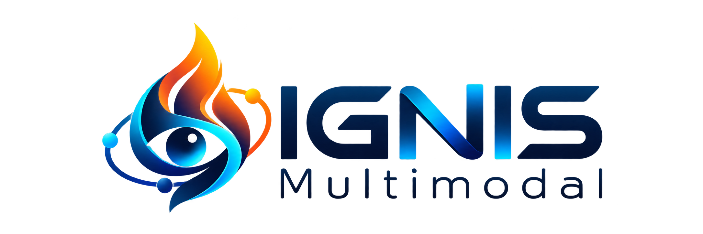
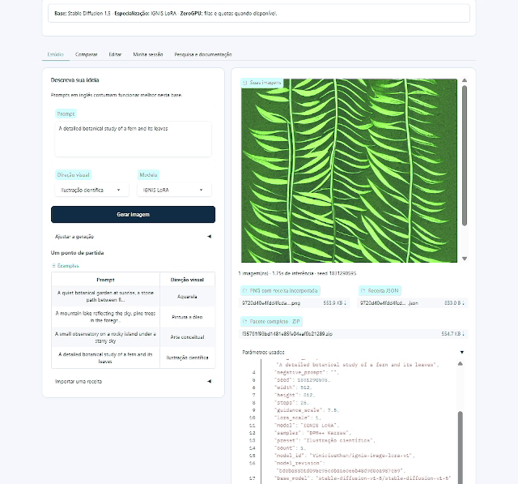
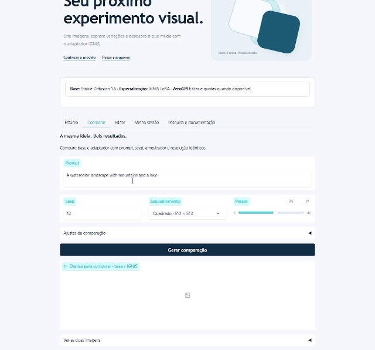
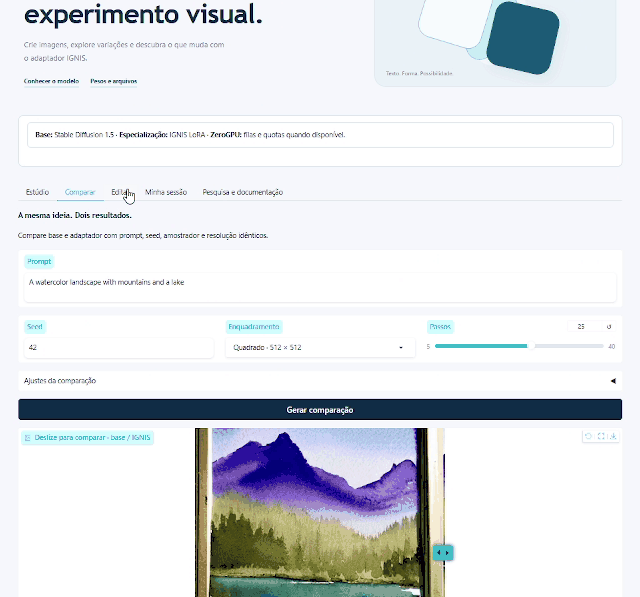
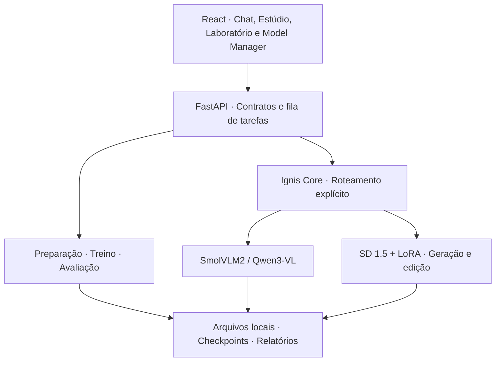

<p align="center">
  
</p>

<h1 align="center">IGNIS Multimodal</h1>

<p align="center">
  <strong>Compreender imagens. Criar possibilidades. Experimentar localmente.</strong><br />
  Plataforma de IA com visão-linguagem, geração e edição de imagens e treinamento LoRA.
</p>

<p align="center">
  <a href="https://huggingface.co/spaces/ViniciusKhan/IGNIS-Image-Lab"></a>
  <a href="https://huggingface.co/ViniciusKhan/ignis-image-lora-v1"></a>
  
  
  
</p>

<p align="center">
  <a href="#demonstrações-reais">Demonstrações</a> ·
  <a href="#o-que-a-plataforma-faz">Recursos</a> ·
  <a href="#executar-localmente">Instalação</a> ·
  <a href="#nosso-primeiro-adaptador">Modelo</a> ·
  <a href="#api-local">API</a> ·
  <a href="huggingface/model/README.md">Documentação do modelo</a>
</p>

---

**IGNIS Multimodal** reúne modelos públicos de visão e difusão em uma aplicação local, com gerenciamento de recursos, interface de laboratório e um pipeline real de adaptação por LoRA. Foi desenvolvido por **Vinicius de Souza Santos**, com foco em experimentação reproduzível em uma GPU de consumo.

A contribuição IGNIS está no orquestrador, na integração, nos pipelines, na interface e no adaptador treinado. Os modelos-base mantêm suas respectivas autorias. O **IGNIS Image LoRA v1** é um adaptador de Stable Diffusion 1.5, distinto do projeto independente IGNIS-30M.

## Demonstrações reais

Os GIFs abaixo foram recortados da gravação fornecida pelo autor, com foco na aplicação. Não são telas simuladas. O vídeo registra o **Space de imagens**; não demonstra todos os módulos da aplicação local.

### 01 · Do prompt à imagem

Geração no Estúdio, ajustes dos controles e resultados na interface.



<sub>Trecho original: 00:00–00:23. Reprodução acelerada em 1,5×; não utilizar a duração do GIF como benchmark de inferência.</sub>

### 02 · Base e adaptador, lado a lado

Compare as saídas com a mesma seed e explore as diferenças pelo controle deslizante.



<sub>Trecho original: 00:26–00:42. Diferença visual não equivale a melhoria comprovada.</sub>

### 03 · Edição e histórico de experimentos

Navegação pelos controles de edição e pela galeria da sessão.



<sub>Trecho original: 00:43–00:54,5. Este recorte mostra navegação e controles; não documenta uma edição concluída.</sub>

[Manifesto dos recortes](docs/media/manifest.json) · [Imagem estática da comparação](docs/media/comparacao.png)

## O que a plataforma faz

| Componente | Funcionalidades implementadas |
|---|---|
| **Ignis Vision** | Perguntas sobre imagens, descrição visual e interpretação de páginas renderizadas de PDF, com SmolVLM2 e Qwen3-VL opcional |
| **Ignis Image** | Texto para imagem com SD 1.5, prompt, seed, resolução e adaptadores LoRA locais |
| **Ignis Edit** | Image-to-image e inpainting com imagem inicial, máscara e intensidade de transformação |
| **Ignis Core** | Roteamento explícito de operações e encadeamento de descrição de uma referência com geração de outra imagem |
| **Laboratório** | Preparação de dados, configuração de treino, execução/retomada, checkpoints, loss, logs e comparação base/LoRA |
| **Model Manager** | Download individual, manifesto, carregamento/descarregamento e consulta de RAM/VRAM |

A aplicação local tem quatro módulos de interface: **Chat Multimodal**, **Estúdio de Imagens**, **Laboratório** e **Model Manager**. O histórico local utiliza SQLite; operações longas são acompanhadas por uma fila de tarefas e logs.

O Core usa regras transparentes e seleção de operações. PDFs são renderizados em até quatro páginas para interpretação visual; esse mecanismo não constitui RAG. O projeto não alega planejamento autônomo ou compreensão ilimitada de documentos.

### Plataforma local e Space

| Recurso | Aplicação local | Space público |
|---|---|---|
| Compreensão de imagens/PDF | SmolVLM2; Qwen opcional | Não incluída nesta demonstração |
| Texto para imagem | SD 1.5 e LoRA instalado | Base e IGNIS LoRA |
| Image-to-image / máscara | Sim | Sim |
| Comparação visual base/LoRA | Script e relatórios no Laboratório | Comparador com slider |
| Dataset e treinamento | Sim, na máquina local | Não expostos ao público |
| Gerenciamento de modelos | Sim | Modelos fixados pela aplicação |
| Receitas PNG/JSON/ZIP | Saídas e relatórios locais | Exportação e importação na interface |
| Histórico | Local, em SQLite | Temporário por sessão |
| GPU utilizada | GPU da máquina local | Recursos do Hugging Face |

O [Space](https://huggingface.co/spaces/ViniciusKhan/IGNIS-Image-Lab) inclui Estúdio, Comparar, Editar, Minha sessão e Pesquisa e documentação. Os presets de estilo modificam o prompt; não representam outros LoRAs treinados.

## Nosso primeiro adaptador

**[IGNIS Image LoRA v1](https://huggingface.co/ViniciusKhan/ignis-image-lora-v1)** foi treinado de fato em uma RTX 4050 Laptop de 6 GB, usando um recorte sintético do DiffusionDB.

| Item | Execução registrada |
|---|---|
| Base | Stable Diffusion 1.5 |
| Adaptação | LoRA no UNet; rank 8 |
| Dataset | 96 imagens sintéticas: 82 treino / 14 validação |
| Resolução | 512 × 512 |
| Batch / acumulação | 1 / 4 |
| Precisão | FP16 mista; parâmetros treináveis em FP32 |
| Learning rate inicial | 0,0001 |
| Passos executados | 550 atualizações do otimizador |
| Parada | Early stopping por validação |
| Melhor checkpoint por loss | Passo 300 |
| Adaptador publicado | Final do passo 550 |
| Loss inicial / final de validação | 0,1939089287 / 0,1931784405 |
| Melhor loss de validação | 0,1931627215 |
| Duração registrada do treino | 842,06 s; exclui instalação, download e avaliação posterior |
| Avaliação qualitativa | 6 pares base/LoRA, com 3 prompts e 2 seeds |

O conjunto de validação não participa das atualizações por gradiente. A comparação não estabelece superioridade geral sobre a base. Não foram calculados FID, CLIPScore ou preferência humana.

**Documentação completa:** [model card](huggingface/model/README.md), com arquitetura, proveniência, configuração, exemplos Python, uso offline, edição, licença, hashes e referências.


## Modelos integrados

| Chave | Repositório público | Função | Licença declarada |
|---|---|---|---|
| `smolvlm` | [HuggingFaceTB/SmolVLM2-500M-Video-Instruct](https://huggingface.co/HuggingFaceTB/SmolVLM2-500M-Video-Instruct) | Compreensão visual leve, primeira opção | Apache 2.0 |
| `qwen` | [Qwen/Qwen3-VL-2B-Instruct](https://huggingface.co/Qwen/Qwen3-VL-2B-Instruct) | Compreensão visual alternativa | Apache 2.0 |
| `sd15` | [stable-diffusion-v1-5/stable-diffusion-v1-5](https://huggingface.co/stable-diffusion-v1-5/stable-diffusion-v1-5) | Geração e edição | CreativeML Open RAIL-M |

Pesos e datasets são baixados separadamente e não estão no Git. O downloader prioriza os arquivos utilizados, registra origem/revisão/licença e reutiliza o cache local. Qwen é opcional; sua memória necessária depende da configuração e da quantização disponível no ambiente.

## Executar localmente

### Requisitos

- Windows com PowerShell.
- Python compatível com as dependências; a execução documentada utilizou Python 3.13.
- Node.js e npm para compilar o frontend.
- GPU NVIDIA com CUDA e driver compatível para o fluxo local documentado.
- Referência de hardware: RTX 4050 Laptop, 6 GB VRAM, 32 GB RAM.
- Espaço para ambientes, pesos, caches e dados; os três conjuntos de modelos utilizados ocuparam aproximadamente 9 GB em arquivos, além desses demais componentes.

### 1. Obter o código

Para uma **instalação nova**, em uma pasta de destino livre:

```powershell
Set-Location C:\dev
git clone https://github.com/ViniciusKanh/IGNIS-llm-Multimodal.git Ignis-Multimodal
Set-Location .\Ignis-Multimodal
```

Se o projeto já está instalado, preserve seus dados e alterações antes de atualizar. Não é necessário clonar por cima da instalação existente.

### 2. Preparar o ambiente

```powershell
.\scripts\bootstrap.ps1
```

O script cria `.venv`, instala dependências Python e compila o frontend. A instalação PyTorch utiliza o índice CUDA configurado no script; confira sua compatibilidade com o driver.

### 3. Baixar os modelos utilizados

```powershell
.\scripts\download-models.ps1 -Models smolvlm,sd15

# Alternativa de visão: opcional, não necessária para começar.
.\scripts\download-models.ps1 -Models qwen
```

### 4. Iniciar

```powershell
.\scripts\start.ps1
```

- **Aplicação:** http://127.0.0.1:8000
- **Documentação interativa da API:** http://127.0.0.1:8000/docs
- **Desenvolvimento:** `.\scripts\start.ps1 -Dev`, com frontend na porta 5173.

O serviço escuta em loopback. A instalação local não é um serviço público autenticado para exposição direta à internet.

### Usar o adaptador já publicado

Não precisa treinar para experimentar o LoRA. Abra o Space ou baixe somente os pesos no diretório esperado pela aplicação:

```powershell
$env:HF_HOME = Join-Path (Get-Location) '.cache/huggingface'
.\.venv\Scripts\python.exe -c "from huggingface_hub import snapshot_download; snapshot_download('ViniciusKhan/ignis-image-lora-v1', revision='bdcba88b1d095e95ccbaa6066b48d9d0ca987e59', allow_patterns=['pytorch_lora_weights.safetensors'], local_dir='training/ignis-image-lora-v1/final')"
```

Esse download disponibiliza o adaptador para inferência; não cria histórico de treino nem substitui relatórios necessários para publicar um novo experimento.

## Treinar outro experimento

O pipeline prepara imagens com legendas, cria uma divisão de treino/validação, treina LoRA, salva checkpoints e oferece retomada. **Treinamento é opcional para iniciar a aplicação.**

```powershell
# Seleciona explicitamente a fonte sintética do primeiro experimento.
.\.venv\Scripts\python.exe scripts/prepare_dataset.py --source diffusiondb --limit 96

# Usa outro nome para preservar a execução original.
.\scripts\train-lora.ps1 -Name ignis-image-lora-v2

# Compara o novo adaptador com a base.
.\scripts\evaluate.ps1 -Adapter 'ignis-image-lora-v2/final'
```

Para dados próprios, coloque imagens em `datasets/` e prepare um JSONL com `file`, `caption`, `license` e `source`:

```powershell
.\.venv\Scripts\python.exe scripts/prepare_dataset.py --metadata minhas-imagens.jsonl
```

A configuração fica em [configs/train.json](configs/train.json). O treino usa AdamW, scheduler cosseno, warmup, gradient checkpointing e acumulação. VAE e embeddings são calculados sequencialmente e mantidos em cache. A retomada considera checkpoints completos da execução correspondente.

O coletor padrão tenta uma fonte museológica e pode recorrer ao DiffusionDB. Uma nova coleta não garante o mesmo recorte: consulte o manifesto e o fingerprint. O fallback de resolução após falta de VRAM registra execuções distintas.

## Comandos úteis

| Comando | Função |
|---|---|
| `scripts/bootstrap.ps1` | Criar ambiente e compilar interface |
| `scripts/download-models.ps1` | Baixar modelos selecionados |
| `scripts/status.ps1` | Consultar modelos, RAM e VRAM |
| `scripts/train-lora.ps1` | Treinar ou retomar LoRA |
| `scripts/evaluate.ps1` | Comparar base e adaptador |
| `scripts/start.ps1` | Iniciar a aplicação local |
| `scripts/prepare-hf-release.ps1` | Preparar release com evidências reais |
| `scripts/deploy-space.ps1` | Criar/atualizar somente o Space em ZeroGPU |
| `scripts/update_model_readme.py` | Atualizar documentação do modelo existente |
| `scripts/prepare_demo.py` | Recriar os GIFs a partir da gravação original |

O preparo do release não publica por padrão. Envio ao Hub exige autenticação e opção explícita de publicação. O deploy do Space solicita exclusivamente ZeroGPU e reutiliza um Space existente; não contrata hardware pago. Regras de elegibilidade e limites são definidos pelo Hugging Face.

## API local

A documentação de contratos, parâmetros e arquivos está disponível em `/docs` quando o backend está iniciado.

| Método | Endpoint | Operação |
|---|---|---|
| GET | `/api/health` | Saúde do serviço |
| GET | `/api/status` | Modelos e recursos |
| POST | `/api/chat` | Interpretação de texto, imagens e PDF |
| GET | `/api/chat/{session}` | Histórico de uma sessão |
| POST | `/api/images` | Geração, image-to-image e inpainting |
| GET | `/api/gallery` | Galeria local |
| POST | `/api/core` | Roteamento ou combinação de operações |
| POST | `/api/models/load` | Carregar modelo |
| POST | `/api/models/unload` | Liberar recursos |
| GET | `/api/lab` | Dataset, adaptadores e avaliações |
| GET / POST | `/api/config` | Consultar/salvar configuração de treino |
| GET / POST | `/api/jobs` | Consultar/iniciar tarefas |
| GET | `/api/jobs/{identifier}/log` | Logs da tarefa |
| POST | `/api/training/stop` | Solicitar parada com preservação de estado |

Exemplo de consulta:

```powershell
Invoke-RestMethod 'http://127.0.0.1:8000/api/status'
```

## Arquitetura



O gerenciamento serializa operações de GPU, descarrega módulos entre modelos e utiliza FP16 e CPU offloading quando necessário. Treinamento e inferência disputam a mesma GPU; evite executá-los simultaneamente.

## Organização do código

| Diretório | Conteúdo |
|---|---|
| `backend/` | API, engine, orquestrador, histórico e tarefas |
| `frontend/` | React, TypeScript e Tailwind |
| `scripts/` | Instalação, downloads, treino, avaliação e publicação |
| `configs/` | Configuração de treinamento |
| `huggingface/model/` | Model card, template e logotipo |
| `huggingface/space/` | Aplicação Gradio e runtime ZeroGPU |
| `skills/ignis-multimodal/` | Skill de desenvolvimento do projeto |
| `tests/` | Contratos e verificações automatizadas |
| `docs/` | Documentação, evidências e demonstrações |
| `models/`, `datasets/`, `training/` | Dados locais; ignorados pelo Git |
| `outputs/`, `logs/`, `.cache/` | Resultados e caches locais; ignorados pelo Git |

## Verificação

```powershell
.\.venv\Scripts\python.exe -m pytest -q

# Habilita testes do transporte HTTP em ambiente com loopback disponível.
$env:IGNIS_TEST_HTTP = '1'
.\.venv\Scripts\python.exe -m pytest -q

Push-Location frontend
npm run build
Pop-Location
```

Testes de contratos não substituem inferência real ou avaliação de qualidade. Nesta versão houve treinamento real e comparação base/LoRA; o runtime de imagens também foi exercitado localmente em geração, comparação, image-to-image e inpainting. O vídeo acima registra o Space sendo utilizado pelo autor.

Para recriar os GIFs, instale as dependências de edição no ambiente que utilizará e forneça a gravação original:

```powershell
python -m pip install opencv-python Pillow
python scripts/prepare_demo.py 'caminho/gravacao.mp4'
```

O recorte está configurado para esta gravação de 1280 × 720; ajuste os intervalos e o enquadramento para outro vídeo.

## Limitações e licenças

- O adaptador é experimental, treinado em um pequeno conjunto sintético; não há comprovação de melhoria geral.
- Prompts em português são aceitos, sem tradução automática ou benchmark linguístico dedicado.
- Inpainting utiliza a base de quatro canais; não garante preservação exata da imagem.
- Safety checker é mantido, mas pode falhar.
- O Space de imagens não disponibiliza visão/PDF, treinamento ou o gerenciamento local.
- A política de hardware e as cotas do Space podem mudar; a GPU local não alimenta o serviço hospedado.

Os pesos-base seguem suas próprias licenças: Apache 2.0 para SmolVLM2/Qwen3-VL e CreativeML Open RAIL-M para SD 1.5 e o adaptador derivado. O recorte do DiffusionDB tem CC0 declarada pelos mantenedores. Consulte os cards e documentos originais; licença de dataset não substitui licença de modelo.

Este repositório não inclui uma licença geral de código concedendo permissões adicionais. Licenças dos modelos e dependências não se aplicam automaticamente à aplicação inteira. Consulte [THIRD_PARTY_NOTICES.md](THIRD_PARTY_NOTICES.md).

## Autoria e colaboração

**Vinicius de Souza Santos** · Ciência de Dados, Machine Learning e desenvolvimento de software.

[GitHub](https://github.com/ViniciusKanh) · [Hugging Face](https://huggingface.co/ViniciusKhan) · [Modelo](https://huggingface.co/ViniciusKhan/ignis-image-lora-v1) · [Demonstração](https://huggingface.co/spaces/ViniciusKhan/IGNIS-Image-Lab)

Para relatar um problema, inclua a operação, versões, hardware e logs sem tokens ou dados pessoais. Propostas de melhoria devem distinguir alterações de interface, comportamento de inferência e evidências de qualidade.
